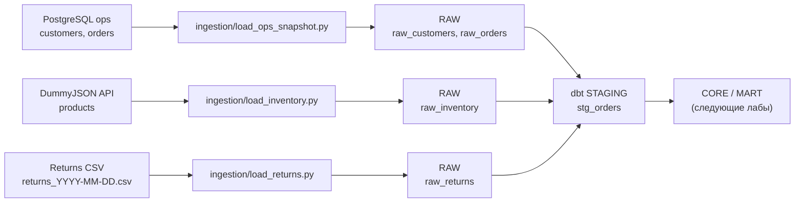

# DataOps Labs 2–4 — учебный E-commerce pipeline

Учебный проект по дисциплине **«Основы DataOps»**. Репозиторий является форком
курса [as4me/dataops](https://github.com/as4me/dataops); материалы лекций и практик
лежат в папках `lectures/` и `practices/`, а код проекта — в корне репозитория.

Студент: [linzaiq-afk](https://github.com/linzaiq-afk)

---

## Что сделано

| Лаба | Тема | Результат | Отчёт |
|---|---|---|---|
| 2 | Жизненный цикл данных, Docker и PostgreSQL | 3 источника, схема слоёв, sample-данные Olist, PostgreSQL 16, схема `ops` | [docs/labs/lab-02.md](docs/labs/lab-02.md) |
| 3 | Data Pipelines и оркестрация | идемпотентная загрузка returns, загрузчики API и ops, генератор CSV, оркестратор с retry/timeout | [docs/labs/lab-03.md](docs/labs/lab-03.md) |
| 4 | Data as Code и Git | dbt-проект, `source()`/`stg_orders`, описания колонок, issue #3, schema change drill | [docs/labs/lab-04.md](docs/labs/lab-04.md) |

Подготовка к защите: [docs/DEFENSE.md](docs/DEFENSE.md).

---

## Архитектура

```text
Sources ──► Ingestion ──► RAW ──► STAGING ──► CORE ──► MART ──► BI
```



Подробно: [docs/architecture.md](docs/architecture.md).

---

## Технологический стек

- **Python 3.10+** — ingestion и оркестратор;
- **PostgreSQL 16** — операционная БД `ops` и слой `raw`;
- **Docker Compose** — воспроизводимый запуск PostgreSQL;
- **dbt Core + dbt-postgres** — трансформации и документация моделей;
- **Git / GitHub** — ветки, коммиты, Pull Request, история изменений.

---

## Структура репозитория

```text
.
├── data/
│   ├── samples/              # sample Olist: customers, orders (по 200 строк)
│   └── returns/incoming/     # сгенерированные CSV с возвратами
├── dbt/
│   ├── dbt_project.yml
│   ├── profiles.yml.example  # шаблон подключения (profiles.yml в gitignore)
│   └── models/
│       ├── sources.yml
│       └── staging/
│           ├── stg_orders.sql
│           └── schema.yml
├── docs/                     # ТЗ, архитектура, отчёты по лабам, защита
├── ingestion/
│   ├── db.py                 # общие настройки подключения
│   ├── load_ops_snapshot.py  # PostgreSQL ops → RAW
│   ├── load_inventory.py     # DummyJSON → RAW
│   └── load_returns.py       # CSV → RAW (идемпотентно)
├── lectures/                 # материалы курса
├── practices/                # материалы курса
├── scripts/
│   ├── generate_returns.py   # генератор CSV возвратов
│   └── raw_quality_check.py  # проверки RAW перед dbt
├── sql/
│   ├── init_ops.sql          # схема ops + customers/orders
│   └── init_raw.sql          # схема raw + raw_* таблицы
├── dag_orchestrator.py       # оркестратор pipeline (замена Airflow)
├── docker-compose.yml
├── requirements.txt
└── README.md
```

---

## Быстрый старт

### 1. Зависимости

```powershell
python -m pip install -r requirements.txt
```

### 2. Переменные окружения

```powershell
Copy-Item .env.example .env
# откройте .env и задайте свой POSTGRES_PASSWORD
```

`.env` находится в `.gitignore` и не попадает в репозиторий.

### 3. PostgreSQL

```powershell
docker compose up -d
docker compose ps
```

При **первом** запуске (пустой volume) PostgreSQL автоматически выполнит
`sql/init_ops.sql` и `sql/init_raw.sql` и создаст схемы `ops` и `raw`.

Если контейнер уже был создан раньше, примените скрипты вручную:

```powershell
Get-Content -Raw sql/init_ops.sql | docker compose exec -T postgres psql -v ON_ERROR_STOP=1 -U dataops -d shop
Get-Content -Raw sql/init_raw.sql | docker compose exec -T postgres psql -v ON_ERROR_STOP=1 -U dataops -d shop
```

Если вы поменяли `POSTGRES_PASSWORD` после первого запуска, старый пароль остался
в volume. Для чистого перезапуска (данные будут удалены):

```powershell
docker compose down -v
docker compose up -d
# затем заново загрузите sample-данные из шага 4
```

### 4. Загрузка sample-данных Olist (лаба 2)

```powershell
docker compose cp data/samples/customers_sample.csv postgres:/tmp/customers_sample.csv
docker compose cp data/samples/orders_sample.csv postgres:/tmp/orders_sample.csv
docker compose exec postgres psql -U dataops -d shop -c "COPY ops.customers FROM '/tmp/customers_sample.csv' WITH (FORMAT csv, HEADER true);"
docker compose exec postgres psql -U dataops -d shop -c "COPY ops.orders FROM '/tmp/orders_sample.csv' WITH (FORMAT csv, HEADER true);"
```

Проверка:

```powershell
docker compose exec postgres psql -U dataops -d shop -c "SELECT COUNT(*) FROM ops.customers;"
docker compose exec postgres psql -U dataops -d shop -c "SELECT COUNT(*) FROM ops.orders;"
docker compose exec postgres psql -U dataops -d shop -c "SELECT COUNT(*) FROM ops.orders o JOIN ops.customers c ON o.customer_id = c.customer_id;"
```

Ожидаемый результат: по 200 строк и 200 совпадений по JOIN.

---

## Лаба 3: ingestion и оркестрация

### Генерация CSV с возвратами

```powershell
python scripts/generate_returns.py
```

### Идемпотентная загрузка

```powershell
python ingestion/load_returns.py --date 2017-04-02
python ingestion/load_returns.py --date 2017-04-02   # повторно
docker compose exec postgres psql -U dataops -d shop -c "SELECT batch_id, COUNT(*) FROM raw.raw_returns GROUP BY batch_id;"
```

Количество строк за `returns_2017-04-02` не удваивается: перед вставкой строки
этого `batch_id` удаляются.

### Проверки RAW

```powershell
python scripts/raw_quality_check.py
```

### Весь pipeline одной командой

```powershell
python dag_orchestrator.py --date 2017-04-02
```

Шаги: `load_ops_snapshot → load_api_inventory → load_returns →
raw_quality_check → dbt_run → dbt_test`. У каждой задачи есть retry (2 повтора)
и timeout; при окончательной ошибке pipeline останавливается.

### Демонстрация сбоя

```powershell
python ingestion/load_returns.py --date 2099-01-01
```

Скрипт завершится с ошибкой «файл не найден», а оркестратор остановит pipeline.
После возврата корректной даты повторный запуск проходит без дублей.

---

## Лаба 4: dbt и Git

### Настройка dbt

```powershell
Copy-Item dbt/profiles.yml.example dbt/profiles.yml
# при необходимости поправьте host/port; пароль берётся из POSTGRES_PASSWORD
$env:POSTGRES_PASSWORD = (Get-Content .env | Where-Object { $_ -match '^POSTGRES_PASSWORD=' }) -replace '^POSTGRES_PASSWORD=', ''
```

`dbt/profiles.yml` в `.gitignore`, потому что содержит параметры подключения.

### Запуск моделей

```powershell
dbt debug --project-dir dbt --profiles-dir dbt
dbt run --project-dir dbt --profiles-dir dbt --select stg_orders
dbt test --project-dir dbt --profiles-dir dbt --select stg_orders
```

Модель `stg_orders` читает `source('raw', 'raw_orders')`, приводит типы и
переименовывает поля. Описания модели и колонок — в `dbt/models/staging/schema.yml`.

### Git-история лабы 4

- Issue: [#3 Add stg_orders](https://github.com/linzaiq-afk/dataops/issues/3)
- Ветка: `lab-04`
- Коммит: `854ae52 feat: add dbt project, staging model, and complete schema change drill`

### Schema change drill

Сценарий: в источнике переименовали поле, старая модель падает с ошибкой
«column does not exist». Порядок действий:

1. зафиксировать ошибку (`dbt run`);
2. найти модель и колонку, которая сломалась;
3. исправить `stg_orders.sql` в отдельной ветке;
4. проверить `dbt run` и `dbt test`;
5. сделать коммит и merge в `main`.

Подробный разбор — в [docs/labs/lab-04.md](docs/labs/lab-04.md).

---

## Источники данных

| Источник | Тип | Что загружаем |
|---|---|---|
| Olist → PostgreSQL | РСУБД | `ops.customers`, `ops.orders` |
| DummyJSON | REST API | товары, цены, остатки, рейтинги |
| Returns CSV | файлы | возвраты по дням |

Полное описание: [docs/sources.md](docs/sources.md).
Полный датасет Olist в Git не коммитится — только sample по 200 строк.

---

## Data Quality

Сейчас реализованы базовые проверки RAW (`scripts/raw_quality_check.py`):
наличие данных, неотрицательный `refund_amount`, заполненный `order_id`,
отсутствие дублей. В dbt добавлены тесты `not_null` и `unique` для `order_id`.

Расширение до 10+ тестов по разным измерениям (completeness, uniqueness,
referential integrity, validity, freshness, business rules) — следующая лаба.

---

## Известные ограничения

- CORE и MART пока не реализованы: в dbt есть только STAGING.
- Вместо Apache Airflow используется учебный оркестратор на Python
  (по условию практики 3 допускается замена с описанием перехода на Airflow).
- CI/CD (GitHub Actions) появится в следующей лабораторной.
- BI-дашборд пока не подключён.

---

## Документация

- [Техническое задание](docs/TZ.md)
- [Чеклист сдачи](docs/CHECKLIST.md)
- [Критерии оценки](docs/GRADING.md)
- [Архитектура](docs/architecture.md)
- [Источники данных](docs/sources.md)
- [Лаба 2](docs/labs/lab-02.md)
- [Лаба 3](docs/labs/lab-03.md)
- [Лаба 4](docs/labs/lab-04.md)
- [Подготовка к защите](docs/DEFENSE.md)
