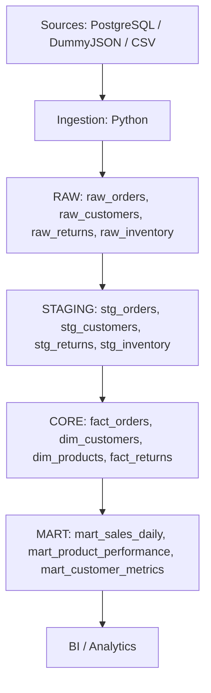

# Архитектура

## Целевая схема слоёв



## Что реализовано к лабораторной №4

| Слой | Статус | Файлы |
|---|---|---|
| Источники | готово | PostgreSQL `ops`, DummyJSON API, returns CSV |
| Ingestion | готово | `ingestion/load_ops_snapshot.py`, `ingestion/load_inventory.py`, `ingestion/load_returns.py` |
| RAW | готово | `sql/init_raw.sql`: `raw_orders`, `raw_customers`, `raw_returns`, `raw_inventory` |
| STAGING | готово | `dbt/models/staging/stg_orders.sql` |
| CORE | план | следующие лабораторные |
| MART | план | следующие лабораторные |
| BI | план | следующие лабораторные |

## Production pipeline

Ежедневный запуск (`dag_orchestrator.py`):

```text
load_ops_snapshot → load_api_inventory → load_returns
    → raw_quality_check → dbt_run → dbt_test
```

- при ошибке задача повторяется (по умолчанию 2 повтора);
- на каждую попытку задан timeout;
- при окончательной ошибке pipeline останавливается с кодом 1;
- каждый шаг пишет строки в лог.

## Development pipeline

1. Создать ветку от `main` (например, `feature/stg-orders`).
2. Внести изменения и сделать коммиты.
3. Push ветки и Pull Request в `main`.
4. Проверить diff, при необходимости исправить.
5. Merge после проверки.

## Environment pipeline

| Окружение | Данные | Что происходит |
|---|---|---|
| DEV | sample 200 строк | разработка и ручные запуски скриптов |
| CI | sample | автоматические проверки (следующая лаба) |
| PROD | полный Olist | ежедневный pipeline и обновление витрин |
