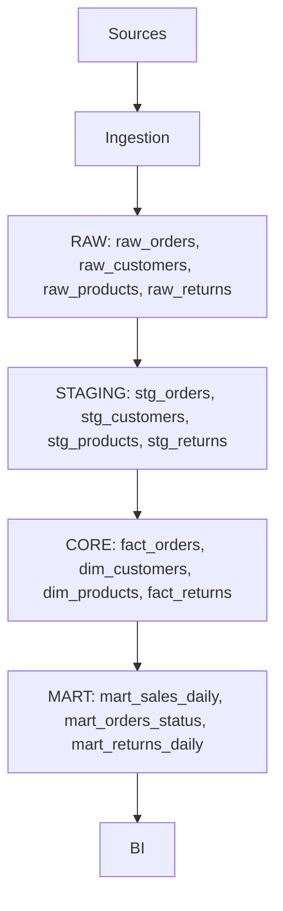

## Production Pipeline

Pipeline запускается ежедневно в 06:00.

1. Получение данных из PostgreSQL, DummyJSON API и Returns CSV.
2. Сохранение исходных данных в RAW.
3. Очистка и подготовка данных в STAGING.
4. Формирование бизнес-таблиц в CORE.
5. Проверка качества данных (Data Quality).
6. Обновление витрин MART.
7. Предоставление обновлённых данных для BI.

При временной ошибке загрузки выполняются повторные попытки (Retry).
Результаты выполнения и ошибки записываются в логи.

## Development Pipeline

1. Создание ветки `lab-02` от `main`.
2. Выполнение лабораторной и изменение файлов.
3. Сохранение изменений через Commit.
4. Создание Pull Request из `lab-02` в `main`.
5. Code Review — проверка изменений и тестов.
6. Исправление ошибок при необходимости.
7. Merge в `main` после проверки.

## Environment Pipeline

1. DEV (Development) — разработка Python-скриптов и SQL-запросов, проверка на небольших sample-данных.
2. CI (Continuous Integration) — автоматический запуск тестов и проверок после изменений в Git.
3. PROD (Production) — ежедневное выполнение Pipeline, обработка рабочих данных и обновление аналитических витрин MART.

Основное отличие окружений: в DEV используются тестовые данные, в CI проверяется корректность изменений, а в PROD выполняется рабочая обработка данных.
